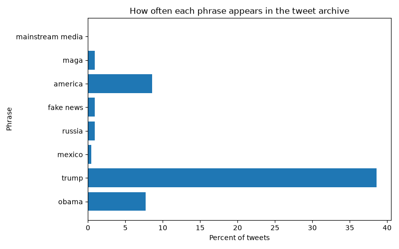

## Results

| phrase            | percent of tweets |
| ----------------- | ----------------- |
|             obama | 07.73             |
|             trump | 38.58             |
|            mexico | 00.45             |
|            russia | 00.91             |
|         fake news | 00.88             |
|           america | 08.58             |
|              maga | 00.93             |
|  mainstream media | 00.03             |

The chart shows that "america" appears in about 8.6% of tweets, far more than "maga" (0.93%) or "mainstream media" (0.03%). I predicted that america would appear most often, so this result confirms my prediction.